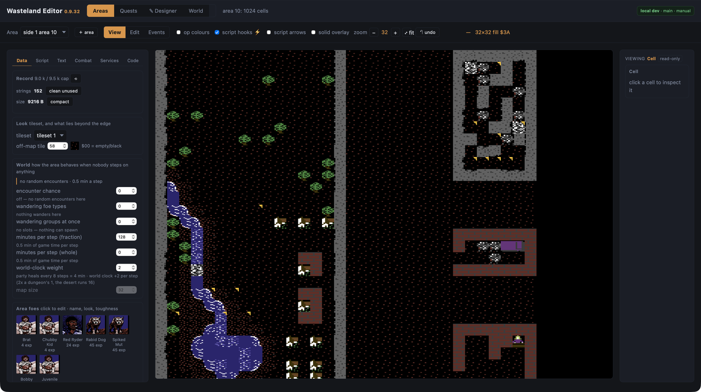

# WL1 Editor

A data editor for **Wasteland** (Interplay / Electronic Arts, 1988, Commodore 64): maps, area
scripts, items, foes, texts, portraits and their animations — read and written through byte-exact
codecs, so anything it saves is something the 1988 engine can load.

Runs locally: a FastAPI backend, a dependency-free JavaScript frontend, and a browser.



**It contains no game data. Not one byte.** No disk images, no maps, no graphics, no text — and
no item or skill names either, because those are the game's prose too. Everything the editor
shows is decoded on your machine from disk images you already own.

---

## Get it running

You need preservation-grade **`.g64`** images of all four sides. A `.g64` keeps the bit-level
track data; the game's loader walks its own directory rather than the CBM filesystem, so a `.d64`
has already discarded what the extractor needs. Bring your own — nothing here helps you obtain
the game, and that is deliberate.

```bash
python3 -m venv .venv && . .venv/bin/activate
pip install -r requirements.txt

python3 bootstrap.py --disks /path/to/your/g64s
bash run.sh                      # http://127.0.0.1:8080
```

That is the whole setup. Python 3.10 or newer, three dependencies, no build step.

`bootstrap.py` writes `data/` — 201 extracted assets, the item and skill names decoded from your
own engine blob, and an empty `work/` for your edits. All of it is git-ignored.

**→ [docs/GUIDE.md](docs/GUIDE.md) — what each screen does, with pictures.**
**→ [docs/APPLE2.md](docs/APPLE2.md) — the Apple II release carries the same data; what it would take to read those disks too.**

---

## Layout

```
backend/    FastAPI app and the codecs — one module per format
frontend/   index.html + main.js + style.css. No framework, no node_modules
tools/      extraction and decoding, each runnable on its own
data/       generated, git-ignored, yours
docs/       the guide and the format notes
```

`WL_DATA` moves the data root; `WL_WORK` and `WL_ASSETS` override the sub-roots.

## Access control

Unset, everything is open — right for `127.0.0.1`. Set `WL_AUTH_EDIT="name:pass"` for full
access, `WL_AUTH_VIEW="name:pass"` for read-only (`GET`/`HEAD` pass, mutating calls get 403).
Either one turns on HTTP Basic for non-LAN clients; **`WL_AUTH_FORCE=1`** closes the LAN
exemption, which you want the moment anything but you can reach the port.

## Keeping it clean

```bash
python3 tools/check_clean.py            # tracked files
python3 tools/check_clean.py --staged   # as a pre-commit hook
```

It fails if anything that looks like game data is tracked or staged — including a source file
that inlines the name tables again.

## Status

An early public cut, carved out of a larger cartridge-porting project.

- The codecs are byte-exact: re-extracting all four sides reproduces the reference set 201 of 201.
- The tests in `backend/_*_test.py` need a populated `data/`; there are no synthetic fixtures yet.
- Parts of `docs/` are in German and were written for the parent project.
- No cartridge build and no emulator integration. This repository edits data.

## Credits and legal

Reverse engineering and the editor: **DKL / TREX**. Portrait art and testing: **LDX#40**.

**License: MIT** (`LICENSE`) — covering this project's own work. It covers nothing about
Wasteland, which is © 1988 Interplay Productions / Electronic Arts. `NOTICE` draws that line and
credits the third-party references this codebase leans on.
