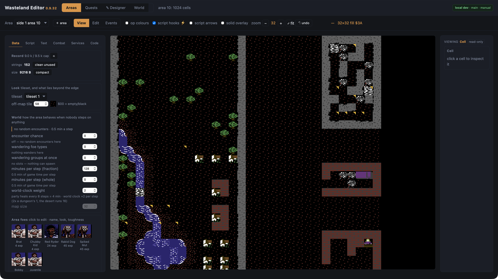
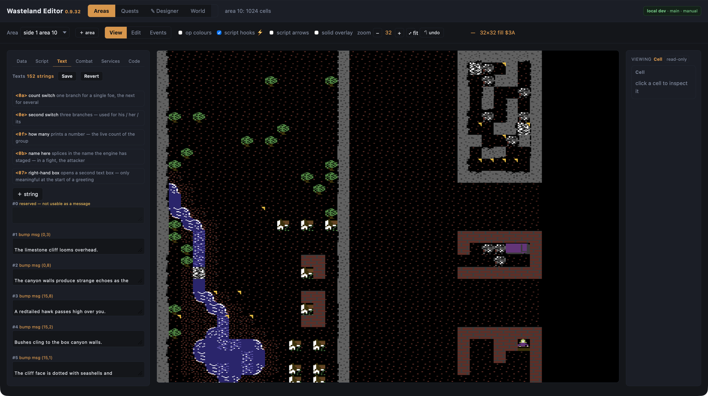
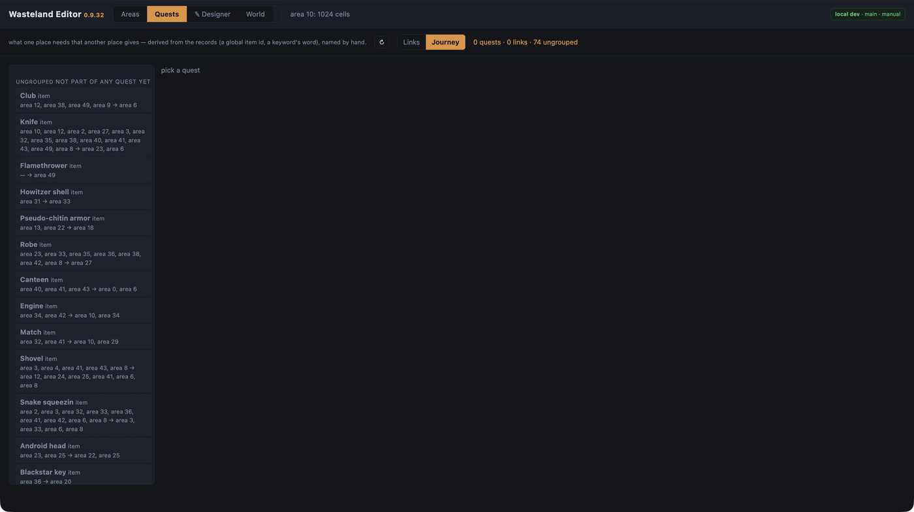
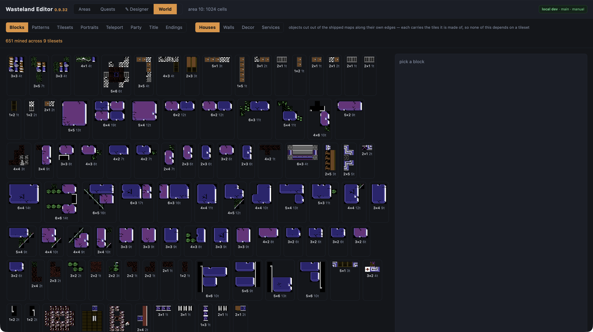
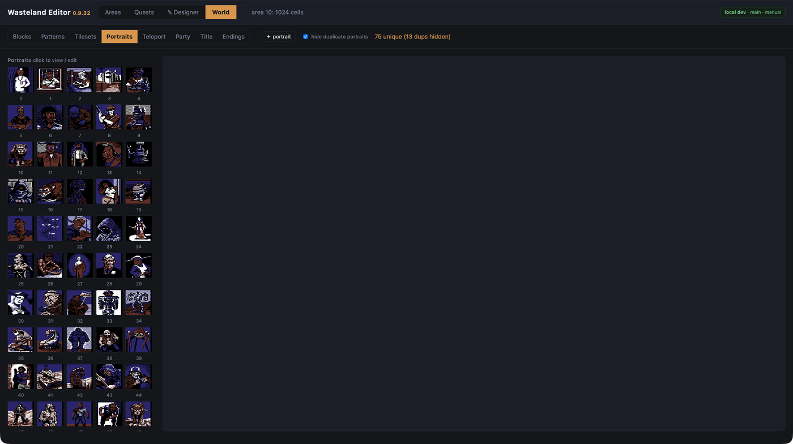

# A tour of the editor

What each screen does, and where its data comes from. Every screenshot here was taken from a
clean checkout: clone, `pip install`, `bootstrap.py`, `run.sh` — nothing else.

> The pictures show the game's own graphics and text, because that is what the editor displays.
> They are the only place in this repository where game content appears at all, and only as
> documentation of the tool.

---

## Areas — one place at a time



The map in the middle is the real thing: tiles decoded from the extracted map blob and drawn with
the area's own tileset. Click a cell and the right-hand panel tells you what the engine would do
when the party steps on it — which op, which record, which message.

The left column is the area record, in six tabs:

| | |
|---|---|
| **Data** | record size against the `$2500` cap, the tileset, the off-map tile, and the world parameters — encounter chance, wandering foes, minutes per step, the world-clock weight that drives healing |
| **Script** | the per-cell scripts: what is on this square and what it does |
| **Text** | the area's string pool |
| **Combat** | the 37 combat messages this area uses |
| **Services** | shops, doctors, banks — their greeting, their wares, their prices |
| **Code** | the area's own 6502 handler (`grp16`), disassembled |

**Area foes** at the bottom are read out of the record's foe table, each with the portrait it
actually uses and its experience value.

`View` / `Edit` / `Events` switch what a click does: inspect, paint, or follow the script graph.

---

## Text — the string pool



Every string the area owns, decoded from the game's 5-bit packed text and editable in place.
Area 10 has 152 of them.

The cards at the top are the control codes the engine understands, traced out of `char_out`
(`$1F03`) rather than guessed:

| | |
|---|---|
| `<0a>` | count switch — one branch for a single foe, another for several |
| `<0e>` | second switch — three branches, used for his / her / its |
| `<0f>` | prints a number — the live count of the group |
| `<0b>` | splices in the name the engine has staged |
| `<07>` | opens the right-hand text box — only meaningful at the start of a greeting |

Saving re-encodes the whole pool and rebuilds the offset table, so the result is something the
1988 engine can load — not a patched blob.

---

## Quests — what one place needs that another gives



Nothing here is hand-written. The graph is derived from the records: every item a script demands
and every item a script hands out, every keyword a character listens for, matched across all 42
areas.

So `Howitzer shell → area 31 → area 33` is not a note someone left; it is what the data says.
`Journey` lays a quest out top-down in sections, one per run of steps in the same place.

---

## World — what the game already has



**Blocks** are objects cut out of the shipped maps along their own edges — houses, walls, decor,
service buildings. 651 of them, mined from the nine tilesets at load time. Each carries the tiles
it is made of, so pasting one into another area does not depend on that area's tileset.

**Patterns** are the recurring arrangements. **Tilesets** shows all nine. **Teleport**, **Party**,
**Title** and **Endings** cover the remaining global tables and the title/endgame pictures.

## World — Portraits



All 88 character portraits, decoded from their multicolour anim-object blobs. 75 are unique; the
editor spots the 13 duplicates and hides them by default.

Click one to open it: the still picture, its animation slots, and a frame-by-frame editor. A
portrait carries no colour data of its own — the window scheme is fixed (black background,
`$26` red/blue on screen, colour RAM `$01`), so at most four colours, and a fifth is refused
rather than silently snapped.

---

## Where the data comes from

```
your .g64 images
    │  tools/wl_g64decode.py          GCR -> tracks and sectors
    │  tools/wl_directory.py          the loader's own zone interleave and step-down order
    │  tools/wl_decompress.py         the $C8EC codec
    ▼
data/baseline/sideN/                  201 assets, read-only reference
    │  the editor copies on first edit
    ▼
data/work/sideN/                      your edits
```

`data/names.json` is separate: `tools/wl_gen_names.py` replays the boot fastloader to pull the
engine out of side 1, then decodes the item and skill names from its text pool at `$29E4`.

Nothing in `data/` is ever committed — see `.gitignore` and `tools/check_clean.py`.

---

## Editing safely

- `baseline/` is never written. Every save goes to `work/`, and the editor prefers a working copy
  over the baseline when both exist. Delete a file in `work/` to get the original back.
- Area records are saved through a **serializer**, not by patching bytes: the record is decoded to
  a JSON intermediate and rebuilt from scratch, so every pointer is recomputed. A save is refused
  if any record the engine can reach would come back different.
- The `.json` beside each `.bin` is that intermediate, and it is the source of truth: edit it in a
  text editor and the next load compiles it.
